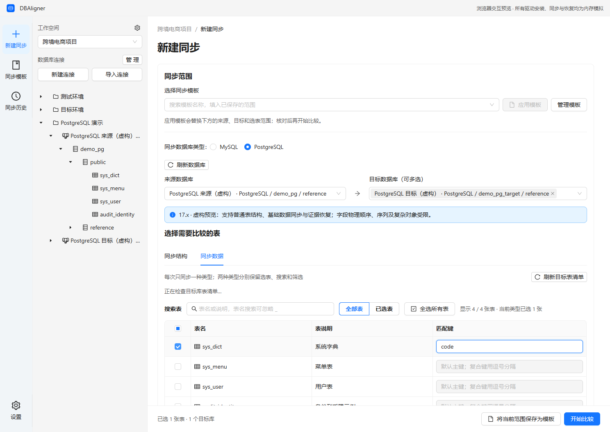
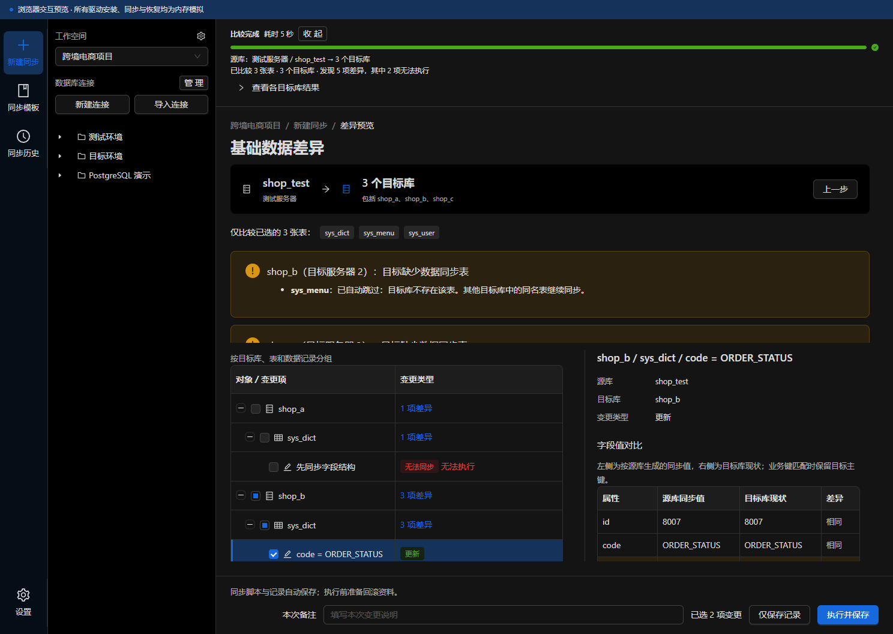

# DBAligner

**面向 Windows 的 MySQL / PostgreSQL 结构与基础数据同步桌面工具。**

选定表，比较一个来源与多个目标，查看差异后导出脚本或执行同步。每次操作保留记录、实际执行结果与恢复资料，方便按工作区管理数据库变更。

[下载安装](https://github.com/zhangxiaowei6/db-aligner/releases) · [使用指南](docs/guide/user-guide.md) · [支持范围](docs/guide/limitations.md) · [文档导航](docs/README.md)

## 核心能力

- **一次比较，多个目标**：按工作区组织连接，选择需要的表，在不同目标间查看差异。
- **结构与数据分别同步**：结构细项按需选择；基础数据支持主键、业务键及复合键匹配。
- **先预览，再确认**：查看源目标定义、字段值、风险及完整已选 SQL，再保存或执行。
- **脚本与客户端执行**：导出脚本交给其他工具执行，或由客户端执行并保存实际结果。
- **记录与恢复资料**：查看执行步骤、追加当前状态核验、预览可信范围的回滚；恢复取决于实际证据与冲突检查。
- **适合重复工作**：同步模板、版本归档、会话导入，以及浅色、深色和跟随系统主题。

## 界面预览

结构差异按目标、表和变更项组织，查看与执行勾选分开：


PostgreSQL 按数据库和 schema 选择同步范围：



深色主题下查看数据差异：



以上截图使用虚构演示数据；实际能力和限制以支持范围为准。

## 下载与快速上手

从 [GitHub Releases](https://github.com/zhangxiaowei6/db-aligner/releases) 下载 Windows x64 **NSIS 安装包**或**完整便携 ZIP**。随包提供 Java 引擎和运行时，无需预装 Java／Maven；电脑缺少 WebView2 时，首次安装需要联网获取。

1. **安装并创建工作区**：新建连接，或导入 Navicat、DBeaver、DataGrip 会话，补充缺失密码。
2. **选择同步范围**：选择数据库类型、一个来源、多个同类型目标，以及需要的表。
3. **比较结构或数据**：按需设置结构细项或数据匹配键，确认范围后开始比较。
4. **查看并选择差异**：检查目标、风险及 SQL；删除和高风险结构变更默认不选。
5. **确认保存或执行**：选择“仅保存记录”或“执行并保存”，确认实际范围和完整已选 SQL，随后到同步历史查看结果。

便携 ZIP 必须完整解压并保留全部资源。安装版可在“设置 → 关于”检查后续正式更新，下载和重启安装均需确认；便携版关闭客户端后替换完整程序目录。Tauri 更新签名与 Windows 代码签名分别管理，未配置后者时 Windows 可能显示未知发布者提示。

## 支持边界

| 项目           | 当前范围                                                               |
| -------------- | ---------------------------------------------------------------------- |
| 平台           | Windows x64                                                            |
| 数据库         | MySQL 5.7／8.0／8.4、PostgreSQL 17.x；同类型之间同步                   |
| 同步类型       | 每次选择结构或数据，跨表也不能混合                                     |
| 基础数据       | 来源及每个目标每表最多 20,000 行，超限阻止，不截断同步                 |
| 目标缺表       | 数据模式跳过；需要时先同步结构，再重新比较数据                         |
| 复杂对象与风险 | 按支持范围阻止；不关闭外键检查绕过约束                                 |
| 回滚           | 依赖可信完成证据、执行后状态及本地恢复资料，不能保证所有操作可自动恢复 |

工具面向结构与基础字典等中小规模数据同步。完整对象支持、权限、恢复限制和未验收项见[支持范围](docs/guide/limitations.md)。浏览器预览只使用内存虚构数据，真实连接和同步使用桌面客户端。

## 开发与贡献

桌面端使用 **Tauri 2 / Rust / React / TypeScript / Ant Design**，引擎使用 **Java 21 / Spring Boot 非 Web 模式 / JDBC**，本地配置和记录使用 SQLite。生产客户端与引擎不启动本地 HTTP 服务。

准备 Windows x64、Node.js 24／npm 11、Rust MSVC 和 Windows C++ 构建工具后，在仓库根目录运行：

```powershell
npm ci
npm run bootstrap
npm run desktop
```

仅查看界面可运行 `npm run dev` 并打开 `http://127.0.0.1:4173/?preview=1`。完整环境、构建及资料目录见[开发指南](docs/development/README.md)，检查组合见[测试指南](docs/development/testing.md)，贡献方式见[CONTRIBUTING](CONTRIBUTING.md)。

问题反馈请使用 [Issues](https://github.com/zhangxiaowei6/db-aligner/issues)，安全问题请使用[私密报告渠道](SECURITY.md)。反馈前移除连接、密码、SQL、SQLite 及其他业务资料。

## 开源与许可

项目采用 [Apache-2.0](LICENSE)。第三方组件保留各自许可，见[第三方说明](THIRD_PARTY_NOTICES.md)。完整分发保留客户端、引擎、运行时与许可材料；MySQL／PostgreSQL 服务端不随客户端分发。

[更新记录](CHANGELOG.md) · [发布流程](docs/development/releasing.md) · [架构与协议](docs/README.md#技术参考) · [验证记录](docs/validation/README.md)
