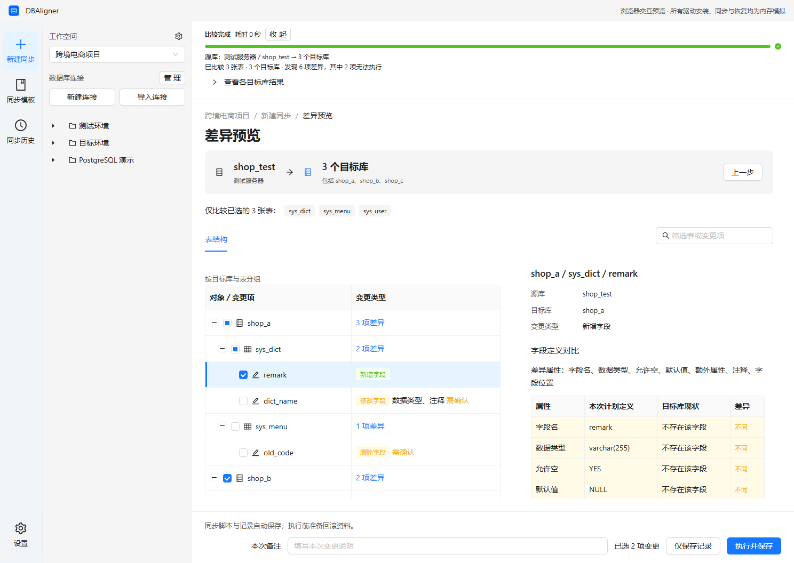

# DBAligner

数据库结构与基础数据同步工具。

按项目组织的 MySQL 结构和基础数据同步桌面工具。选择表后比较一个源库与多个目标库，预览差异，保存脚本或直接执行，保留每次操作的记录、恢复资料和版本归档。

当前版本：**0.1.2，Windows x64**。Electron / React 19 / TypeScript / Ant Design 6，Java 21 / Spring Boot 4 非 Web 引擎，SQLite 本地存储。生产客户端不启动 HTTP 服务，不需要预装 Java 或 Maven。



## 安装与使用

从 [GitHub Releases](https://github.com/zhangxiaowei6/db-aligner/releases) 下载 Windows x64 正式安装包；尚未公开的版本不在下载列表中。本地构建结果在 `release/DBAligner Setup 0.1.2.exe`。安装包随附 Java 运行时，无需系统 Java／Maven；首版未签名，Windows 可能显示未知发布者提示。卸载默认保留应用资料。

安装版启动后自动检查一次正式版本，在“设置 → 关于”确认下载，再确认重启安装。有运行、排队或取消中的任务时不能安装；网络失败不阻塞数据库功能。更新访问 GitHub，不上传连接、密码、SQL、记录或档案。旧的本地客户端需先手动安装含更新能力的版本。干净安装及真实两版本更新的实际验收范围见[验证记录](docs/validation.md)。

无需安装 ZIP 须完整解压，运行其中的 `DBAligner.exe`；本地也可运行 `release/win-unpacked/DBAligner.exe`。升级先关闭客户端，再替换完整程序目录，保留业务资料及档案。首版自动更新针对 NSIS 安装版。

1. 新建项目工作区；创建连接或导入 Navicat `.ncx`、DBeaver `data-sources.json`、DataGrip `dataSources.xml` / XML 文本。导入先预览，选择工作区与重复项处理方式，补充缺失密码。
2. 展开左侧连接与数据库。双击表名查看字段、索引、外键、属性和建表 SQL；右键表或数据库进入同步结构、同步数据或导出结构。
3. 选择一个源库、多个目标库与指定表。每次选择同步结构或同步数据，不能同时同步；数据模式仅同步两边都存在的同名表，目标缺表自动跳过，并可指定主键或业务匹配键。可以保存模板，模板使用时重新比较。
4. 在差异页按目标库、表和变更项勾选。删除和高风险结构变更默认不选。使用“仅保存记录”导出脚本供其他工具执行，或“执行并保存”由客户端备份、执行并记录实际结果。
5. 历史页勾选多条记录标记版本号和说明，也可追加到已有版本。记录详情提供脚本、执行结果、状态核验与回滚预览。
6. 设置页提供浅色、深色和跟随系统主题，选择后立即生效并自动保存到本机 `ui-preferences.json`，不受同步任务执行状态影响。Windows 标题栏使用系统原生窗口按钮；关闭按钮和 Alt+F4 在有运行或排队任务时会要求确认。

详细说明见 [使用指南](docs/user-guide.md)、[支持范围与限制](docs/limitations.md)、[验证记录](docs/validation.md)。

## 开发

需要 Windows x64、Node.js 24 / npm 11。`npm ci` 会显式准备 Electron 运行时；Java 21 和 Maven 使用项目内工具链，不改系统 PATH、不注册 Windows 服务。首次准备依赖和工具链需要网络访问。

```powershell
npm ci
npm run bootstrap
npm run engine:build
npm run desktop
```

`npm run desktop` 启动开发用 Vite 与真实 Electron / Java 引擎，使用项目内 `.local-data`。不要同时启动占用 4173 端口的预览实例。正式安装的资料位于全新的 `%APPDATA%/db-aligner-desktop/data`，需要重新配置连接；旧应用资料保留在原目录，不自动迁移或删除。可以通过 `DB_ALIGNER_HOME` 指定隔离资料目录，指定后 Electron 配置也隔离在该目录的 `electron-profile` 中。

仅看界面时运行 `npm run dev`，打开 `http://127.0.0.1:4173/?preview=1`。浏览器预览带有明确提示，只使用内存中的虚构示例数据，不连接数据库、不执行同步，关闭后不保存。真实功能必须使用桌面客户端。

```powershell
npm run typecheck
npm test
npm run build
npm run qa:ui -w desktop
npm run qa:tree -w desktop
npm run qa:ui -w desktop -- --performance
npm run qa:desktop -w desktop
npm run dist
```

`npm test` 运行前端和引擎默认测试，默认跳过真库；`npm run build` 构建前端与 Electron，不构建引擎。Maven 入口为 `mvnw.cmd` 或 `scripts/mvn.ps1`。

界面验收先运行 `npm run build`，原生桌面验收还需可用引擎构建。脚本使用本机 Chrome／Edge，可通过 `DB_ALIGNER_QA_BROWSER` 指定程序；浏览器验收用虚构数据，原生验收用隔离资料目录。

| 验收命令（仓库根目录）                              | 主要用途                                  | 报告                                                  |
| --------------------------------------------------- | ----------------------------------------- | ----------------------------------------------------- |
| `npm run qa:ui -w desktop`                          | 布局、主题与业务交互                      | [浏览器 UI](docs/react-ui-qa.json)                    |
| `npm run qa:tree -w desktop`                        | 1,000／5,000 表虚拟滚动、重查、刷新与重试 | [连接树](docs/tree-qa.json)                           |
| `npm run qa:ui -w desktop -- --tree-organization`   | 分组与原生 HTML5 拖拽                     | [连接组织](docs/tree-organization-qa.json)            |
| `npm run qa:ui -w desktop -- --context-feedback`    | 右键反馈隔离与当前页面编辑                | [右键反馈](docs/context-feedback-qa.json)             |
| `npm run qa:ui -w desktop -- --record-confirmation` | 全目标记录脚本、回滚详细确认与取消        | [记录与回滚确认](docs/record-confirmation-ui-qa.json) |
| `npm run qa:desktop -w desktop`                     | 原生窗口、主题持久化与关闭确认            | [桌面](docs/react-desktop-qa.json)                    |

截图保存在 `docs/screenshots/react-ant-design/`，视觉复核见[设计 QA](design-qa.md)。验证组合与前置条件见[验证技能](.agents/skills/verification/SKILL.md)，实际执行结果与限制见[验证记录](docs/validation.md)；这些报告路径保存对应最近一次结果，不是每次历史运行的独立快照。

SQL 分页、大清单虚拟滚动与后端热点见[性能排查](docs/performance.md)。专项性能验收使用生产前端和虚构数据，最新指标保存到 `docs/performance-ui-qa.json`，不连接数据库或证明真实同步成功。

## 手动构建安装包

在 Windows x64 上准备 Node.js 24 / npm 11，打开 PowerShell，进入项目根目录（包含根 `package.json` 的目录）。依赖和工具链已准备好时，执行：

```powershell
npm run dist
```

首次在这台机器上构建，或在全新检出中构建时，依次执行：

```powershell
npm ci
npm run bootstrap
npm run dist
```

`bootstrap` 将 Java 21 和 Maven 下载到项目 `.tools`，无需预装 Java / Maven；首次准备依赖和工具链需要网络。根目录的 `npm run dist` 会依次构建 Java 引擎、前端与 Electron，准备裁剪后的 Java 运行时，整理第三方许可，最后生成 Windows x64 NSIS 安装包。使用根目录的完整打包命令；`npm run dist -w desktop` 只运行 Electron 打包，不会重新构建引擎、界面、运行时或许可材料。

产物保存在项目根目录的 `release` 中，当前版本为 0.1.2：

- 安装包：`release/DBAligner Setup 0.1.2.exe`。
- 无需安装的程序：`release/win-unpacked/DBAligner.exe`；直接运行或分发时需保留完整 `win-unpacked` 目录及其资源。

安装包版本取自 `desktop/package.json`，升级版本后以实际生成的文件名为准。安装包附带 Java 运行时，用户机器无需预装 Java；当前未配置代码签名。打包成功不能替代前端、真库及干净 Windows 环境的安装验收，相关要求见[贡献说明](CONTRIBUTING.md)和下方真库回归。

## 真库回归

测试助手下载 Oracle 官方 MySQL Windows ZIP，只启动项目 `.tools/mysql-test` 内的隔离实例，绑定 `127.0.0.1`，不注册服务。它会生成随机测试凭据（不得提交）；测试只创建并清理自己的 `ds_it_*` 数据库。SSL 回归必须有 OpenSSL；脚本支持 `-OpenSsl` 或 `DB_ALIGNER_OPENSSL`，并探测 PATH 和 Git for Windows 安装位置，缺失或不可用时失败，不静默跳过 SSL。

```powershell
./scripts/mysql-test-server.ps1 -Version 5.7.44 -Port 33957
./scripts/mysql-test-server.ps1 -Version 8.0.45 -Port 33980
./scripts/mysql-test-server.ps1 -Version 8.4.8 -Port 33984
./scripts/mvn.ps1 test '-Ddbaligner.mysql.versions=5.7.44,8.0.45,8.4.8' '-Ddbaligner.electron.smoke=true'
./scripts/mysql-test-stop.ps1
```

启用原生打包测试前先运行 `npm run dist`。原生测试使用独立资料目录，清空 `JAVA_HOME`、限制 PATH，从打包客户端验证 IPC、系统密码加密、真实连接、比较、保存、执行、导出和回滚。该测试不等于干净 Windows 虚拟机中的安装验收。

## 工程结构

- `desktop/src`：页面、交互和类型；`desktop/electron`：受限 IPC、凭据、文件对话框和引擎生命周期。
- `engine/src/main/java/io/dbaligner`：连接、元数据、比较、执行、归档、版本、核验、回滚和本地备份。
- `scripts`：工具链、构建、许可与隔离真库测试；`docs`：使用、协议、架构和验收证据。
- `licenses`：第三方许可、驱动源码 JAR 与依赖清单；`design-qa.md`：设计复核。

## 开源

主仓库为 [GitHub](https://github.com/zhangxiaowei6/db-aligner)。主分支推送自动检查并打包为 Actions Artifact；推送 `vX.Y.Z` 标签生成 Release 草稿，完成安装／升级验收后由维护者公开。普通本地打包固定禁用发布。版本、权限、附件及验收步骤见 [GitHub 构建与发布](docs/releasing.md)。安全问题见 [安全报告](SECURITY.md)。

文档入口见下节；维护要求见[贡献说明中的文档规范](CONTRIBUTING.md#文档规范)。

项目代码采用 [Apache-2.0](LICENSE)。第三方组件保持各自许可，见 [第三方声明](THIRD_PARTY_NOTICES.md)。MariaDB Connector/J 以独立、未修改 JAR 分发，附带匹配源码与 LGPL 文本；Java 运行时保留法律文件与对应源码地址。MySQL 服务端不随客户端分发。

提交前阅读 [贡献说明](CONTRIBUTING.md)。不要提交连接导出文件、真实凭据、本地数据库、SQL 档案或 `.tools` 中的测试资料。

## 文档导航

| 阅读目的               | 入口                                                                 |
| ---------------------- | -------------------------------------------------------------------- |
| 完成日常业务操作       | [使用指南](docs/user-guide.md)、[支持范围](docs/limitations.md)      |
| 理解内部机制与接口     | [架构与证据模型](docs/architecture.md)、[本地协议](docs/protocol.md) |
| 开发界面与交互         | [交互规范](docs/interaction-guidelines.md)                           |
| 核对历史验收与视觉样本 | [验证记录](docs/validation.md)、[设计 QA](design-qa.md)              |
| 修改、合并或清理文档   | [文档规范](CONTRIBUTING.md#文档规范)                                 |
| 使用项目开发技能       | [任务与技能索引](AGENTS.md#2-任务与技能索引)                         |
